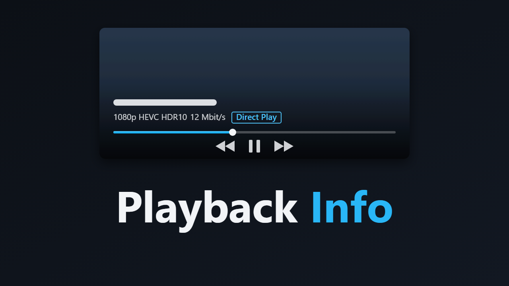

# Playback Info – Jellyfin-Plugin (Jellyfin 12.x)



Zeigt im Webplayer, solange die Bedienelemente sichtbar sind, eine unaufdringliche Zeile mit der
Videoqualität und der Wiedergabeart – ähnlich wie Fladder:

- Auflösung (`4K`, `1080p`, `720p` …), Videocodec mit Farbtiefe (`HEVC 10-bit`) und HDR-Format
  (`HDR10`, `HDR10+`, `Dolby Vision`, `HLG`)
- Bitrate: die der Datei bzw. beim Transcoding die Zielbitrate
- Wiedergabeart: **Direct Play**, **Direct Stream** oder **Transcoding** (bzw. „Transcoding (nur Audio)“)
- beim Transcoding die Ausgangsqualität (`4K HEVC 10-bit → 1080p H.264`) und der Grund aus Jellyfins
  `TranscodeReasons`, z. B. „Bitrate über dem Limit“ oder „Audiocodec nicht unterstützt“
- optional Audiocodec und Kanäle (`AC3 5.1 → AAC Stereo`)

Wer mit der Maus über der Zeile bleibt, bekommt als Tooltip alle Details: Container, Profil, Bildrate,
Quell- und Ausgabestreams, Hardwarebeschleunigung und Fortschritt des Transkodierens.

Die Zeile sitzt direkt in Jellyfins Bedienleiste unter dem Titel und blendet sich mit ihr ein und aus.
Ohne sichtbare Bedienelemente bleibt das Bild frei. Die Texte sind deutsch oder englisch, je nach
Sprache des Webclients.

## Installation

### Über das Plugin-Repository (mit Updates)

1. *Dashboard → Plugins → Repositorys → +* und diese URL eintragen:
   `https://raw.githubusercontent.com/skriewel/jellyfin-plugins/main/manifest.json`
   Das ist der gemeinsame Katalog aller meiner Jellyfin-Plugins.
2. Im Katalog **Playback Info** auswählen und installieren, danach Jellyfin neu starten.
3. Im Browser einmal hart neu laden (Strg+F5).
4. Neue Versionen erscheinen dann als Update im Dashboard.

Voraussetzung: Das GitHub-Repo ist öffentlich, sonst kann Jellyfin Manifest und Paket nicht laden.

### Manuell

1. `build.ps1` ausführen (oder das fertige `dist\PlaybackInfo_1.0.0.1.zip` nehmen).
2. Den Ordner `dist\PlaybackInfo_1.0.0.1` (mit `Jellyfin.Plugin.PlaybackInfo.dll` und `meta.json`) in das
   Plugin-Verzeichnis des Servers kopieren:
   - Docker: `/config/plugins/PlaybackInfo_1.0.0.1/`
   - Linux (Paket): `/var/lib/jellyfin/plugins/PlaybackInfo_1.0.0.1/`
   - Windows: `%ProgramData%\Jellyfin\Server\plugins\PlaybackInfo_1.0.0.1\`
3. Jellyfin neu starten und im Browser einmal hart neu laden (Strg+F5).
4. Einstellungen: *Dashboard → Plugins → Playback Info*.

Voraussetzung: Jellyfin **12.x** (gebaut und getestet gegen 12.4, .NET 10). Weitere Plugins sind nicht nötig.

## Einstellungen

Auflösung und Wiedergabeart werden immer angezeigt.

| Option | Standard | Bedeutung |
|---|---|---|
| Plugin aktiv | an | Hauptschalter |
| Videocodec | an | z. B. `HEVC 10-bit` |
| HDR-Format | an | HDR10, HDR10+, Dolby Vision, HLG; bei SDR erscheint nichts |
| Bitrate | an | Bitrate der Datei bzw. Zielbitrate beim Transcoding |
| Audiocodec und Kanäle | aus | z. B. `AC3 5.1` |
| Ausgangsqualität beim Transcoding | an | `4K HEVC → 1080p H.264` |
| Grund für das Transcoding | an | aus `TranscodeReasons` (auf schmalen Bildschirmen ausgeblendet) |

Farben per Custom CSS anpassen (*Dashboard → Allgemein → Custom CSS*), zum Beispiel:

```css
.pbiOsd { --pbi-text: rgba(255,255,255,.7); --pbi-transcode: #ff8a65; }
```

## Woher die Daten kommen

- **Wiedergabeart und Transcoding** stammen aus der Server-Session dieses Browsers (`/Sessions?deviceId=…`):
  `PlayState.PlayMethod` und `TranscodingInfo` mit `TranscodeReasons`, Zielauflösung, Codecs, Bitrate
  und Hardwarebeschleunigung. Das sind dieselben Daten, die das Dashboard unter „Aktive Geräte“ zeigt.
- **Die Originalqualität** kommt aus den `MediaSources` des Elements (passend zur abgespielten Version).
- Remuxing (Video und Audio werden kopiert, nur der Container wechselt) wird als **Direct Stream** angezeigt;
  wird nur der Ton umgewandelt, als **Transcoding (nur Audio)**.
- Abgefragt wird nur, solange die Bedienelemente sichtbar sind (alle 5 Sekunden), sonst entsteht kein Traffic.
  Nach einem Qualitätswechsel im Player dauert es deshalb bis zu 5 Sekunden, bis die Zeile nachzieht.

## Einschränkungen

- Nur der Webclient (auch Jellyfin Media Player und Apps, die den Webclient einbetten). Native Apps
  wie Fladder, Swiftfin oder Findroid laden kein Web-Skript.
- Die Einbindung setzt auf die Klassen des Webplayers in Jellyfin 12.4 (`#videoOsdPage`,
  `.videoOsdBottom-maincontrols`). Ändert ein künftiges jellyfin-web diese Struktur, erscheint die
  Zeile nicht mehr; die Wiedergabe selbst ist davon nie betroffen.

## Skript-Einbindung

Wie bei Jellyfin Enhanced: Eine ASP.NET-Middleware ergänzt `index.html` beim Ausliefern um ein `<link>`-
und ein `<script>`-Tag. Dateien im Web-Ordner werden nicht geschrieben, File Transformation ist nicht nötig,
und das Ganze verträgt sich mit JE, File Transformation und JS Injector, weil jeder nur seine eigenen Tags
anhängt.

## Projektstruktur

```
Jellyfin.Plugin.PlaybackInfo/
  Plugin.cs                         Plugin-Klasse, Konfigurationsseite, Cache-Key
  PluginServiceRegistrator.cs       registriert die Injection-Middleware
  Injection/ScriptInjectionStartupFilter.cs   ergänzt index.html beim Ausliefern
  Api/PlaybackInfoController.cs     /PlaybackInfoOsd/ClientScript, /PlaybackInfoOsd/ClientStyle
  Configuration/                    Einstellungen + Dashboard-Seite
  Web/playbackinfo.js, playbackinfo.css   Client-Code
build.ps1                           Build + Paket (dist/)
update-manifest.ps1                 trägt die Version mit Prüfsumme in manifest.json ein
```

## Neue Version veröffentlichen

1. Version in der `.csproj` und als Standardwert in `build.ps1` erhöhen, Changelog in `build.ps1` anpassen.
2. `.\build.ps1` ausführen: baut das Paket nach `dist\` und trägt die Version mit Prüfsumme in `manifest.json` ein.
3. Commit und Push, dann das GitHub-Release anlegen (Tag `v<Version>`, das ZIP aus `dist\` anhängen):
   `gh release create v<Version> dist\<Paket>.zip --title "<Name> <Version>"`

Der Download-Link in `manifest.json` zeigt auf genau dieses Release-Asset, deshalb müssen Tag und Dateiname passen.
